# PayFlow Guard — Architecture

Companion to `PLATFORM.md` (shared blueprint), `docs/FOUNDATION_CONTRACT.md` (foundation internals) and
`docs/DOMAIN_CONTRACT.md` (domain build spec, revision 3). This document shows how the pieces fit; the contracts define the exact shapes.

Stack (PLATFORM §0.10, ADR-0014): **Laravel + Vue** (`apps/web`), **Node.js + BullMQ/Redis** (`apps/worker`: queues, schedulers, webhook
ingress, grammY Telegram bot **and the TypeScript RAG**), **Playwright** (`e2e`), PostgreSQL + pgvector, Redis. There is no Python/FastAPI service.

## 1. System context

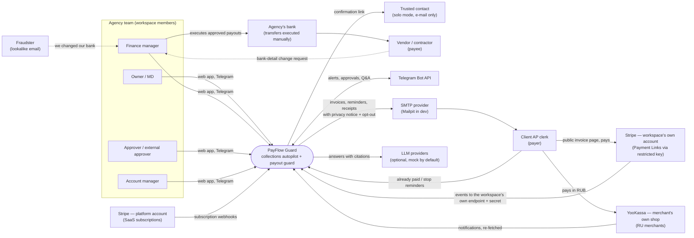

PayFlow Guard never moves or holds money itself (ADR-0008): client payments are Stripe Payment Links on the workspace's own Stripe account
(restricted key, per-workspace webhook endpoint) or its own YooKassa shop through the foundation `PaymentGateway` (ADR-0013, PLATFORM §11.2);
vendor payouts are approved in PayFlow and executed by the customer in their bank. Stripe Connect is v2.

## 2. Containers

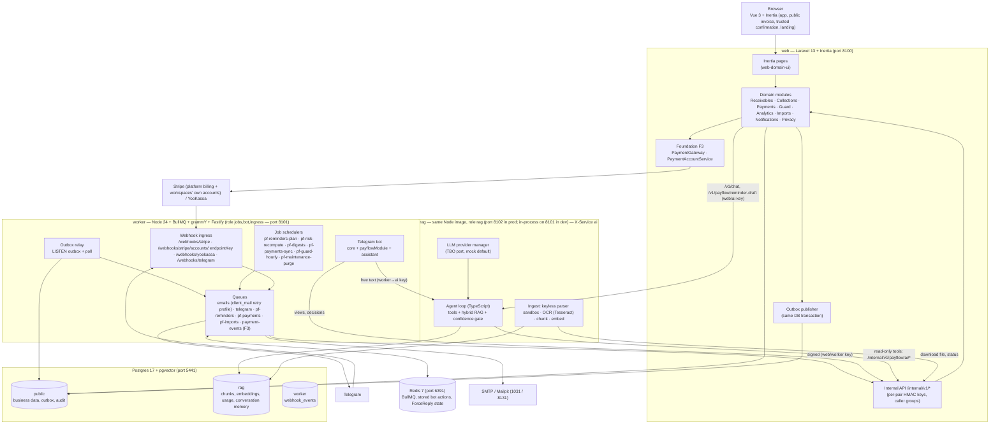

Service rules (PLATFORM §3): web owns all business rules and data; the worker owns timing, retries, delivery and webhook ingress and
calls web for every decision; the RAG role (wire name `ai`, ADR-0014) never writes business tables and reads domain data only through
permission-checked, read-only tools. Internal calls are signed with a key per service pair and every internal route declares its allowed callers
(ADR-0010, overrides PLATFORM §4.1).

## 3. Data flow — from invoice to cash (and from request to payout)

```mermaid
flowchart LR
    subgraph AR["Money in"]
        create["Create / import invoice<br/>(imports start paused)"] --> activate["Activation review<br/>(tones, throttle)"]
        create --> issue["Issue: number, PDF,<br/>payment link, email v2"]
        activate --> plan
        issue --> public["Public invoice page<br/>(views tracked if enabled)"]
        issue --> plan["Planner: due steps, client-tz window,<br/>first-contact cap, tone"]
        plan --> remind["Reminder emails<br/>(outbox → emails queue, retries)"]
        remind --> public
        public --> pay["Client pays via Payment Link on<br/>the workspace's Stripe / YooKassa"]
        public --> choice["Already paid /<br/>stop automated reminders"]
        choice --> plan
        pay --> hook["Provider event: workspace endpoint,<br/>own secret, dedupe"]
        hook --> record["Record payment,<br/>update status"]
        manual["Manual payment<br/>(bank transfer)"] --> record
        record --> stats["Client stats, risk score,<br/>analytics, Telegram"]
        stats --> plan
    end
    subgraph AP["Money out"]
        req["Bank-detail change request"] --> score["Risk scoring<br/>(lookalike, holder, country…)"]
        score --> hold["Hold vendor payouts,<br/>alert eligible verifiers"]
        hold --> verify["Callback verification<br/>by a second eligible person (step-up)"]
        verify --> cool["Cooling-off"]
        payout["Payout request"] --> prisk["Payout risk (incl. split) +<br/>required approvals"]
        cool --> prisk
        prisk --> approve["Approvals (web / Telegram /<br/>trusted contact), four-eyes"]
        approve --> release["Release with bank reference<br/>(customer pays in bank)"]
    end
    stats -.-> rag1[("RAG + tools")]
    score -.-> rag1
```

## 4. Domain data model (simplified ER)

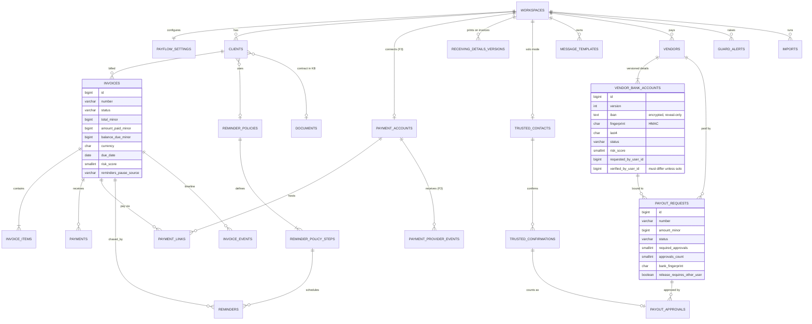

## 5. State machines

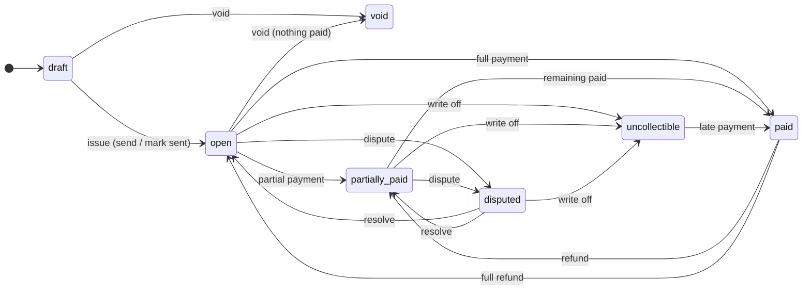
*Invoice. "Overdue" and "due soon" are derived display states, not stored. Reminder pauses (manual, import review, client reported paid,
recipient opt-out) are flags, not statuses.*

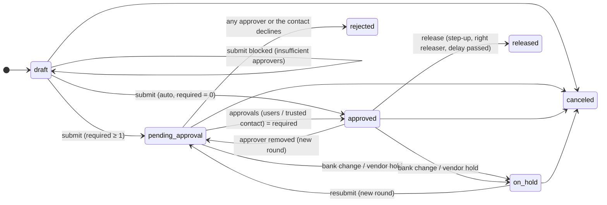
*Payout request.*

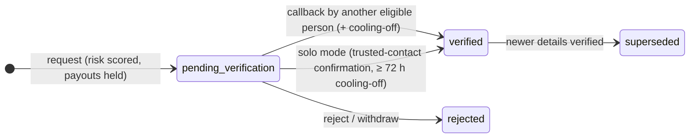
*Vendor bank account version.*

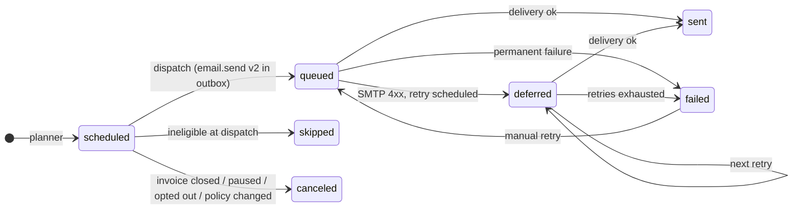
*Reminder.*

## 6. Core flows

### 6.1 Invoice → payment link → client pays → provider event → paid

```mermaid
sequenceDiagram
    autonumber
    actor F as Finance (web)
    participant W as web (Laravel + F3 PaymentGateway)
    participant DB as Postgres (public)
    participant S as Stripe (workspace's own account) / fake checkout
    participant R as worker (relay + queues)
    actor C as Client
    participant T as Telegram

    F->>W: POST /invoices (save & send)
    W->>DB: BEGIN, insert invoice, items, assign number
    W->>S: Price + Payment Link with the workspace's restricted key (completed_sessions.limit=1)
    S-->>W: plink_… url
    W->>DB: payment_links row, outbox email.send v2 (invoice_issued, attachment by internal_path), COMMIT, NOTIFY outbox
    R->>DB: claim outbox rows (SKIP LOCKED)
    R->>R: emails queue (jobId = outbox id, client_mail retry profile)
    R->>W: GET /internal/v1/payflow/invoices/{id}/pdf (signed, web/worker key)
    R-->>C: email (sender name, Reply-To, PDF, legal footer) with link to /i/{token}
    R->>W: POST /internal/v1/deliveries (sent)
    C->>W: GET /i/{token} (view recorded if enabled)
    C->>W: POST /i/{token}/pay
    W-->>C: redirect to Payment Link / fake checkout (YooKassa: payment created now)
    C->>S: pays
    S->>R: POST /webhooks/stripe/accounts/{endpoint_key} (stripe-signature)
    R->>W: GET /internal/v1/payments/endpoints/{key} (worker only; secret cached in memory 5 min)
    R->>R: verify with that workspace's secret (±300 s), dedupe (stripe_account, event.id) in worker.webhook_events
    R->>R: enqueue payment-events (jobId pevt-stripe-{event.id})
    R->>W: POST /internal/v1/payments/events (F3, worker only)
    W->>DB: BEGIN, provider event (unique driver+event_id), account from the endpoint key → workspace
    W->>DB: domain listener: payment (unique payment_intent), invoice paid, cancel reminders, deactivate link
    W->>DB: outbox email.send (receipt) + telegram.notify (payment_received), COMMIT
    R-->>C: receipt email
    R->>T: "Payment received …" to finance / owner
    Note over R,W: Every 30 min payments:sync calls PaymentGateway::listCompletedSessions<br/>for active links in case an event was lost.
    C->>W: GET /i/{token}/status (thanks page polling) → paid
```

### 6.2 Reminder planning and dispatch

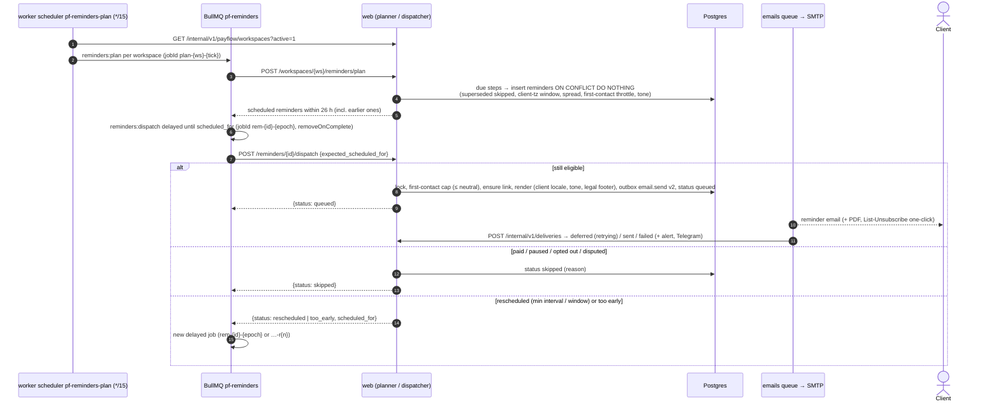

### 6.3 Bank-detail change → verification → four-eyes payout (with Telegram approval)

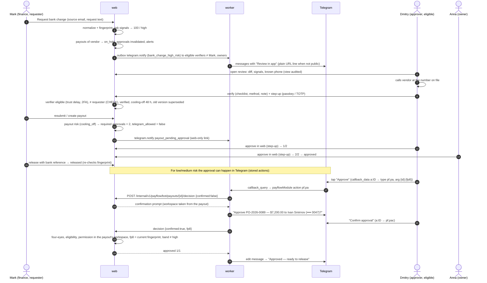

### 6.4 Telegram question answered with tools + RAG

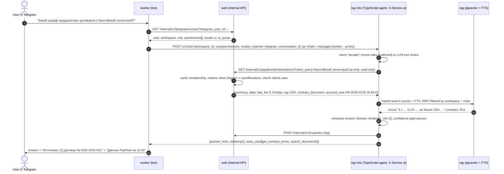

## 7. Cross-cutting concerns

| Concern | Approach |
|---|---|
| Idempotency | Outbox `jobId = outbox id`; provider events deduped by `(driver, event_id)` in worker **and** web; `payments.provider_payment_id` unique; reminders unique per (invoice, step); all job ids use `-` separators (BullMQ 5 rejects `:`); dispatch re-validates state |
| Time | `Clock` interface (web), `now` override only when not production and `DEV_ROUTES=1`; workspace timezone for business dates, client timezone for send slots; BullMQ delays computed from UTC |
| Security | Per-pair HMAC keys + caller-scoped internal routes (ADR-0010), RAG in its own container with a keyless parser sandbox (ADR-0014); per-workspace Stripe webhook secrets + restricted keys encrypted (ADR-0013), YooKassa IP allow-list and re-fetch; encrypted bank data (display vs reveal-only) + HMAC fingerprints; four-eyes enforced in policy and DB CHECK; privileged roles owner-granted with trust delay; `guard.stepup` with passkey/TOTP; high-risk approvals web-only; CSP `default-src 'self'` |
| Privacy | Masked bank data everywhere except audited reveal; no holder names to AI; PII redaction for external LLMs; recipient notice and opt-out in every client e-mail; retention purge, export, anonymisation, actor pseudonymisation (DOMAIN_CONTRACT L) |
| Observability | Request id end-to-end; Prometheus metrics in worker (`pf_*`); structured JSON logs; audit log for money/security actions and retention runs |
| Offline | Fake payment driver (Stripe-shaped events signed with the fake account's secret through the real per-workspace ingress), Telegram outbound capture, mock LLM, hash embeddings — every flow incl. E2E runs without keys |
| i18n | Client-facing texts rendered in the client's locale; team-facing in the user's; RU plurals via `trans_choice` / `Intl.PluralRules`; money formatting CLDR-identical on server and client; no emoji anywhere |

## 8. Deployment

`docker-compose.prod.yml`: `postgres` (pgvector), `redis` (AOF), `web` (FrankenPHP, non-root, `php artisan migrate --force` on release),
no Laravel cron — all schedules live in the worker's BullMQ Job Schedulers (ADR-0004); `worker` (2 replicas safe:
schedulers are Redis-coordinated, relay uses `SKIP LOCKED`; `WORKER_ROLES=jobs,bot,ingress`), `rag` (same image, `WORKER_ROLES=rag`, port 8102,
internal network only; `WORKER_ROLES=all` is refused in production). There is no Python container. The worker is the only public webhook
endpoint besides web (`WORKER_PUBLIC_URL`: `/webhooks/stripe`, `/webhooks/stripe/accounts/:endpointKey`, `/webhooks/yookassa`, `/webhooks/telegram`).
Secrets: three internal pair keys (worker holds web/worker + worker/ai, rag holds web/ai + worker/ai), the platform Stripe webhook secret,
`APP_KEY` (encryption of bank data, restricted keys and per-workspace webhook secrets; fingerprints). Backups: nightly `pg_dump` + WAL
archiving; Redis is reconstructible (outbox + self-healing planner; stored bot actions simply expire). A RU deployment runs in a RU region
(`DATA_REGION=ru`, PLATFORM §11.4).

## 9. ADR index

| ADR | Decision |
|---|---|
| [0001](adr/0001-positioning-collections-and-payout-guard.md) | Position as collections autopilot + payout guard on top of existing invoicing (import-first); freelancers served through solo mode |
| [0002](adr/0002-client-payments-on-workspace-stripe-account.md) | Restricted Stripe key with a per-workspace webhook endpoint — reinstated in amended form by 0013 |
| [0003](adr/0003-deterministic-rule-based-scoring.md) | Deterministic, explainable rule-based scoring (late-payment probability, tone, bank-change & payout risk); LLM only for wording and Q&A |
| [0004](adr/0004-two-phase-reminder-scheduling.md) | Reminder scheduling: worker schedulers + web-owned planning + re-validation at dispatch (self-healing, idempotent, BullMQ-safe ids) |
| [0005](adr/0005-four-eyes-approvals-and-telegram-limits.md) | Four-eyes approvals bound to amount + bank fingerprint; Telegram approvals only for low/medium risk (amended by 0011) |
| [0006](adr/0006-bank-details-encryption-and-fingerprints.md) | Bank details: versioned, encrypted at rest, HMAC fingerprints for equality, masked by default, audited reveal |
| [0007](adr/0007-money-minor-units-no-fx.md) | Money as integer minor units + currency; no FX conversion; CLDR-exact formatting |
| [0008](adr/0008-control-layer-no-money-movement.md) | PayFlow is a control layer: it never initiates bank transfers or holds funds |
| [0009](adr/0009-client-payments-via-payment-gateway.md) | *Superseded by 0013* — Stripe Connect Express via the foundation `PaymentGateway` |
| [0010](adr/0010-per-pair-internal-keys-and-caller-scoped-routes.md) | Per-pair internal API keys and caller-scoped internal routes (overrides PLATFORM §4.1) |
| [0011](adr/0011-insider-resistant-four-eyes-and-solo-mode.md) | Insider-resistant four-eyes: owner-only privileged grants, trust delay, narrow auto-approval, split detection, second-factor step-up, external approver and solo mode |
| [0012](adr/0012-domain-privacy-retention-and-pseudonymisation.md) | Domain privacy: retention, export, anonymisation, recipient notice and opt-out, actor pseudonymisation |
| [0013](adr/0013-client-payments-payment-links-on-workspace-stripe-account.md) | Client payments per PLATFORM §11.2: Payment Links on the workspace's own Stripe account (restricted key, per-workspace endpoint + secret, reconciliation), YooKassa for RUB, fake offline, Connect = v2 |
| [0014](adr/0014-rag-and-ai-tools-in-the-node-service.md) | Strict stack: RAG, agent tools and provider manager in TypeScript inside the Node service (roles `jobs,bot,ingress` / `rag`, keyless parser sandbox); no Python |
| [0015](adr/0015-saas-billing-markets-and-stripe-catalog.md) | SaaS billing by market: gateway per workspace country (Stripe USD/EUR, YooKassa RUB), Stripe catalog by lookup key via `billing:sync-stripe`, webhook-only subscription state with dunning |
